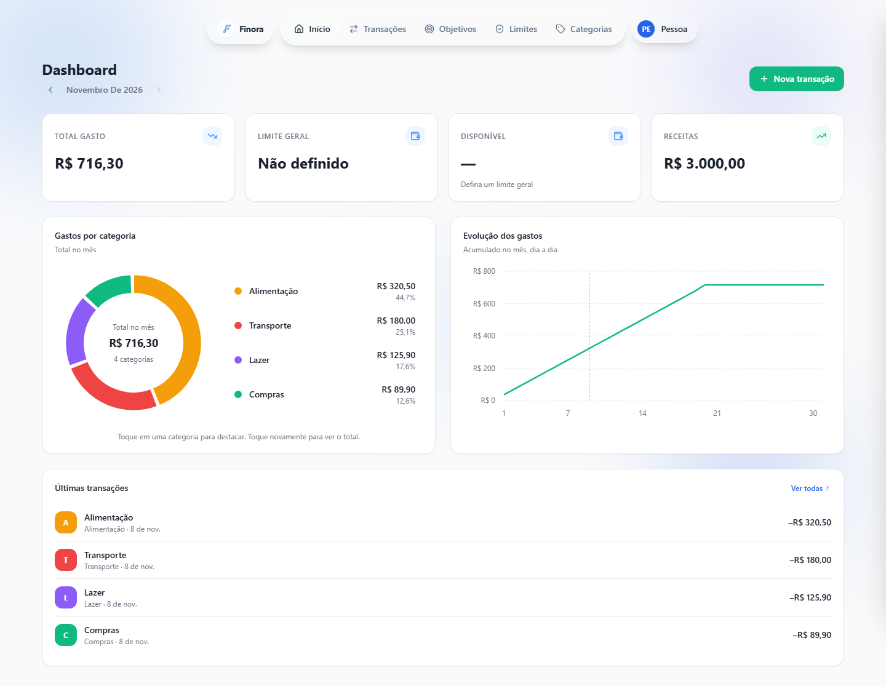
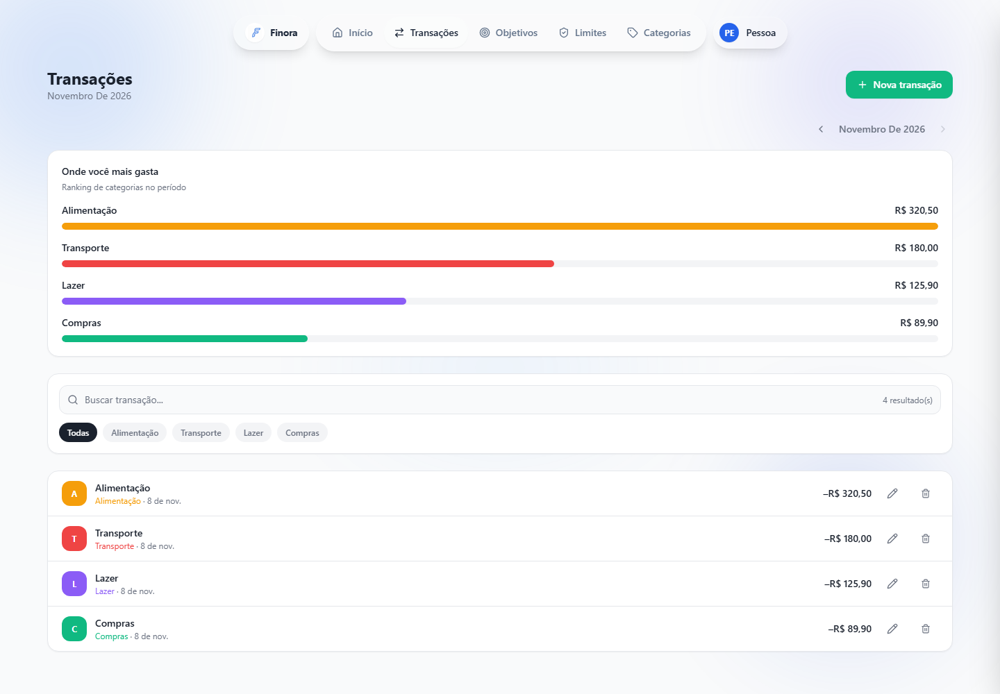

# Finora — gestão financeira pessoal

Aplicação web para acompanhar receitas e despesas, visualizar gastos por categoria e planejar objetivos financeiros. O projeto reúne uma interface React com uma API Node.js e PostgreSQL.

**[Acessar o Finora](https://finorafin.vercel.app)** · [Instalação local](#instalação-local) · [Testes](#testes)

## Funcionalidades

- Cadastro e autenticação de usuários.
- Registro e edição de transações, com categorias e importação e exportação de CSV.
- Dashboard com gráficos de gastos e acompanhamento de limites mensais.
- Criação de objetivos financeiros e registro de contribuições.
- Interface responsiva para uso em diferentes tamanhos de tela.

## Telas

As imagens mostram a interface com dados fictícios e respostas de API simuladas.

**Dashboard**



**Transações**



## Tecnologias

| Camada | Tecnologias |
| --- | --- |
| Frontend | React, TypeScript, Vite, React Router, TanStack Query e Tailwind CSS |
| Backend | Node.js, TypeScript, Express, Prisma e PostgreSQL |
| Testes | Vitest, Testing Library e Playwright |
| Infraestrutura | Docker Compose para o banco local; frontend e API publicados em Vercel e Render |

O frontend consome a API HTTP. A API valida as requisições, aplica as regras de negócio e acessa o PostgreSQL por meio do Prisma. O repositório está organizado em `frontend/` e `backend/`.

## Instalação local

### Pré-requisitos

- Git e Node.js 20 ou superior, com npm.
- PostgreSQL acessível localmente. Os exemplos abaixo usam Docker Compose para iniciar apenas o banco.

### 1. Clone e configure o backend

```bash
git clone https://github.com/AulusHZP/Finora-Finance.git
cd Finora-Finance/backend
npm ci
cp .env.example .env
```

No Windows PowerShell, use `Copy-Item .env.example .env` no lugar de `cp`. O arquivo de exemplo contém valores de desenvolvimento para o banco local. Ajuste `DATABASE_URL`, `DIRECT_URL` e `JWT_SECRET` se usar outra configuração; não use os valores de exemplo em produção.

Inicie o PostgreSQL, gere o cliente Prisma e aplique as migrações existentes em um **banco novo e dedicado ao Finora**. A migração de reconstrução do esquema remove tabelas antigas; confira o histórico antes de aplicá-la a um banco com dados.

```bash
docker compose up -d db
npx prisma generate
npx prisma migrate deploy
npm run dev
```

A API usa `http://localhost:4000` por padrão. Se utilizar outro PostgreSQL, configure as duas URLs de conexão no `.env` e dispense o comando Docker.

### 2. Configure o frontend

Em outro terminal:

```bash
cd Finora-Finance/frontend
npm ci
npm run dev
```

O Vite está configurado para usar `http://localhost:8080`. Em desenvolvimento, o frontend usa `http://localhost:4000` como endereço padrão da API. Se necessário, crie `frontend/.env.local` com `VITE_API_URL` apontando para o endereço desejado. Para experimentar com seus próprios dados, crie uma conta na aplicação local.

## Testes

Os testes cobrem, entre outros pontos, formatação de valores, exportação CSV, interface de transações e serviços de transações e alertas. Execute-os a partir das respectivas pastas:

```bash
# frontend/
npm test
npm run lint
npm run typecheck

# backend/
npm test
```

O diretório `frontend/e2e/` contém testes Playwright da interface para gráficos e criação de transações. Eles usam respostas de API simuladas e dados fictícios: não exercitam a API ou um banco de dados reais. Para executá-los:

```bash
cd frontend
npx playwright install chromium
npm run test:e2e
```

A configuração do Playwright inicia o Vite na porta 5173 para os testes, com endereço de API isolado. As instruções acima não representam uma execução ou resultado de testes.

## Build e publicação

`npm run build` gera o frontend em `frontend/dist`. No backend, `npm run build` gera o cliente Prisma e compila o TypeScript; `npm start` aplica as migrações e inicia o servidor compilado. Em produção, configure as URLs de banco, o segredo JWT e `CORS_ORIGIN` no backend e `VITE_API_URL` no frontend de acordo com o ambiente de hospedagem.

## Autor

[Áulus Batista](https://github.com/AulusHZP) · [LinkedIn](https://www.linkedin.com/in/aulus-batista/)
